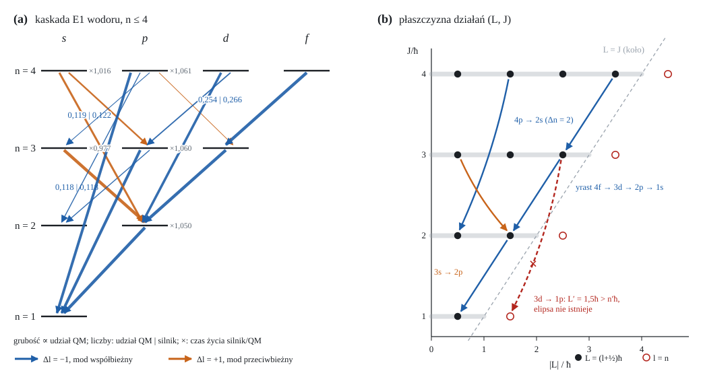

# Klasyczna elektrodynamika pozytonium i wodoru z czterema zasadami kwantowymi

**Tadeusz Sławomir Pytlos**

*Oprogramowanie i pełny zapis audytów: CREM-QI, <https://github.com/pytlotad/CREM-QI>
(model fizyczny: `Model.md`; audyty: `audits/2026-09-10-para-ortho-after-dipole-fix.txt`, dane:
`audits/data/section-NNN/`). Numery w nawiasach kwadratowych [NNN] odsyłają do audytów.*

---

## Streszczenie

Badamy, jak daleko relatywistyczna klasyczna elektrodynamika dwóch naładowanych cząstek
z momentami magnetycznymi odtwarza pomiary pozytonium (Ps) i wodoru, jeśli treść kwantową
ograniczyć do jawnie zadeklarowanego minimum. Dynamika obejmuje retardowane pola
Liénarda–Wiecherta, oddziaływanie dipol–dipol z członem kontaktowym, kowariantne pędy
spinowe, precesję BMT i promieniowanie rozłożone na mody klasycznego pola orbity. Treść
kwantowa to cztery zasady w kolejności postulatów mechaniki kwantowej: **(I) wartości**
(kwantowanie EBK z fazą Maslowa), **(II) elementy macierzowe** (korespondencja Borna w
punkcie środkowym z jednym członem porządku), **(III) prawdopodobieństwa** (reguła Borna)
i **(IV) punkt $r=0$** (gęstość kontaktu oraz liczby QED z literatury). Żaden parametr nie
jest dopasowany do danych; wejściami są $\alpha$, masy, zmierzone momenty magnetyczne i
czynniki $g$. Model daje czasy życia p-Ps i o-Ps do $1{,}5\cdot10^{-4}$ i $6\cdot10^{-5}$,
rozszczepienie nadsubtelne 1s Ps do $6\cdot10^{-5}$, strukturę $n=2$ Ps do $0{,}23$ GHz,
strukturę subtelną i nadsubtelną $2P$ wodoru oraz czynnik $g$ elektronu związanego
w granicach niepewności pomiarów. Granice są nazwane: tempo E1 stanów $p$ (2p wodoru
$+4{,}7\,\%$, $\sim19\sigma$), brak przesunięcia Lamba w poziomach i skład stanów własnych
w polu pośrednim, którego żadna z sześciu sprawdzonych dróg klasycznych nie odtwarza.

---

## 1. Wstęp

Klasyczny atom wodoru jest niestabilny. Promieniuje i kolapsuje w czasie rzędu
$10^{-11}$ s, nie ma dyskretnego widma ani reguł wyboru. Znane jest też, gdzie klasyce
brakuje treści: w fazie de Broglie'a, która daje warunek kwantowania, w
nieprzemienności, która daje elementy macierzowe, i w regule Borna. Mniej znane jest,
**ile z obserwowanych liczb** daje sama klasyczna elektrodynamika, gdy te braki uzupełni
się możliwie oszczędnie i każde uzupełnienie nazwie.

Tę ilość mierzymy. Model łączy pełną relatywistyczną dynamikę dwóch ciał z momentami
magnetycznymi z czterema zasadami kwantowymi. Każdą sprawdzamy pod kątem tego, czy da się
ją wyprowadzić z dynamiki. Wynikiem są zarówno liczby zgodne z pomiarem, jak i wyniki
negatywne: miejsca, w których klasyka zawodzi w sposób mierzalny, z oszacowaną skalą.
Porównujemy się z pomiarami. Wyjątkiem są tempa E1 wodoru: wzór Gordona jest tam ścisły
do $\alpha^2$, a stare pomiary metodą folii odbiegają od niego o $\sim9\,\%$ [616].

---

## 2. Dynamika klasyczna

### 2.1. Skale

Cząstka $i$ ma masę $m_i$, ładunek $q_i$ i moment magnetyczny
$\boldsymbol\mu_i=(g_i/2)\,(q_i/2m_i)\,\mathbf S_i$ o długości ze zmierzonego $g_i$.
Dla pary o masie zredukowanej $\mu$:

$$
k=\alpha\hbar c,\qquad a=\frac{\hbar^2}{\mu k},\qquad B=\frac{k}{2a},\qquad
\omega_n=\frac{2B}{\hbar n^3},\qquad E=-\frac{B\hbar^2}{J^2},
$$

gdzie $J=J_r+L$ jest głównym działaniem Delaunaya, a mimośród spełnia
$e^2=1-(L/J)^2$. Moment magnetyczny jest pętlą prądu o najmniejszym promieniu
$R=\hbar/(m c)$, przy którym ładunek $e$ niesie $\mu$ z prędkością nie większą niż $c$.
Pole dipola jest rozmyte profilem Plummera o długości $\varepsilon=0{,}967\,r^*$, gdzie
$r^*=\mu/(ec)$ (dla e⁺e⁻ $r^*=193$ fm, $a=105{,}8$ pm). Długość $\varepsilon$ nie jest
dopasowana: profil ma tę samą wagę kontaktową co jednorodny dysk pętli.

### 2.2. Ruch ładunków

Pędy są relatywistyczne, $\mathbf p_i=\gamma_i m_i\mathbf v_i$. Pole cząstki $j$ to pole
Liénarda–Wiecherta w chwili opóźnionej:

$$
\mathbf E_j=\frac{q_j}{4\pi\varepsilon_0}\left[\frac{(\hat{\mathbf n}-\boldsymbol\beta)(1-\beta^2)}{\kappa^3R^2}
+\frac{\hat{\mathbf n}\times\big((\hat{\mathbf n}-\boldsymbol\beta)\times\dot{\boldsymbol\beta}\big)}{c\,\kappa^3R}\right]_{\rm ret},
\qquad \mathbf B_j=\frac{\hat{\mathbf n}\times\mathbf E_j}{c},\qquad \kappa=1-\hat{\mathbf n}\cdot\boldsymbol\beta ,
$$

a siła to $\mathbf F_i=q_i(\mathbf E_j+\mathbf v_i\times\mathbf B_j)$. Wszystko jest
dokładne we wszystkich rzędach $v/c$.

### 2.3. Ruch i siły momentów

Moment partnera daje rozmyte pole dipola z członem magnetyzacji, tak że
$\nabla\cdot\mathbf B=0$; daleko

$$
U_{dd}=\frac{\mu_0}{4\pi r^3}\Big[\boldsymbol\mu_1\cdot\boldsymbol\mu_2-3(\boldsymbol\mu_1\cdot\hat{\mathbf r})(\boldsymbol\mu_2\cdot\hat{\mathbf r})\Big]
-\frac{2\mu_0}{3}\,\boldsymbol\mu_1\cdot\boldsymbol\mu_2\,\delta^3(\mathbf r).
$$

Siła na moment zawiera gradient energii oraz tempo pędu ukrytego. W postaci kowariantnej
[570] pędy spinowe to $p'^{\mu}_{\rm hid}=\mathbf m_0\times\mathbf E'/c^2$ oraz człon
typu Tulczyjewa $p'_T=q(\mathbf E'\times\mathbf S_0)/(mc^2)$, gdzie
$\mathbf E'=\gamma(\mathbf E+\mathbf v\times\mathbf B)-\tfrac{\gamma^2}{\gamma+1}(\mathbf v\cdot\mathbf E)\mathbf v/c^2$
jest polem w układzie spoczynkowym. Pędy te są transformowane jak czterowektory, a siła
to $-dp^\mu/d\tau$ rzutowane prostopadle do $u$. Sektor dipolowy jest kowariantny do
$4\cdot10^{-5}$, a moment siły zgodny z precesją do $6\cdot10^{-4}$.

Spiny precesują zgodnie z równaniem BMT:

$$
\frac{d\mathbf S}{dt}=\frac{q}{m}\,\mathbf S\times\left[\Big(\frac g2-1+\frac1\gamma\Big)\mathbf B
-\Big(\frac g2-1\Big)\frac{\gamma}{\gamma+1}(\boldsymbol\beta\cdot\mathbf B)\boldsymbol\beta
-\Big(\frac g2-\frac{\gamma}{\gamma+1}\Big)\frac{\boldsymbol\beta\times\mathbf E}{c}\right].
$$

W estymatorze sekularnym (torze produkcyjnym) ruch jest uśredniany po orbicie. Precesja
zgadza się wtedy człon po członie z klasycznym hamiltonianem Breita–Pauliego rzędu
$1/c^2$ [467], na przykład dla spinu–orbity

$$
\boldsymbol\Omega_{SO,i}=\frac{k}{c^2}\left[\frac{g_i-1}{2m_i^2}+\frac{g_i}{2m_1m_2}\right]\langle r^{-3}\rangle\,\mathbf L .
$$

### 2.4. Promieniowanie

Dipol pary $\mathbf d=q_{\rm ef}\mathbf r$ rozkłada się na harmoniczne orbity Keplera:

$$
x+iy=\sum_{s\ge1}\Big(c_{s,+}\,e^{-is\Omega t}+c_{s,-}\,e^{+is\Omega t}\Big),\qquad
P_{s,\pm}=\frac{q_{\rm ef}^2(s\Omega)^4|c_{s,\pm}|^2}{6\pi\varepsilon_0c^3}.
$$

Mod współbieżny ($+$) niesie $L_z/E=+1/(s\Omega)$, a przeciwbieżny ($-$) $-1/(s\Omega)$.
Uśredniony po orbicie moment siły reakcji promieniowania spełnia w każdym punkcie
$\mathbf r\times\dot{\mathbf a}=-\mathbf L/r^3$ [597]. Moment pędu nigdy więc nie zmienia
kierunku, a mod współbieżny niesie 95–98 % momentu siły [598]. Klasycznie orbita
promieniuje w sposób ciągły i kolapsuje. Dyskretność wprowadzają dopiero zasady z
sekcji 3.

### 2.5. Tryb fotonowy

W trybie produkcyjnym ciągła reakcja Landaua–Lifszyca jest zastąpiona procesem
punktowym. Orbita porusza się zachowawczo, a foton jest emitowany w chwili, gdy
skumulowany hazard przekroczy próg $\mathrm{Exp}(1)$:

$$
\lambda(t)=\sum_{s,\pm}\frac{P_{s,\pm}}{\hbar\,s\Omega},\qquad
\int_{t_0}^{t_\gamma}\lambda\,dt=\xi,\quad \xi\sim\mathrm{Exp}(1).
$$

Mod $(s,m)$ jest losowany z wagą proporcjonalną do liczby jego kwantów. Emisja zabiera
$\Delta n=\min(s,\lfloor n-1\rfloor)$ kwantów głównego działania $J$ i $\hbar$ momentu
pędu wzdłuż osi orbity. Ponieważ $E$ zależy tylko od $J$, energia orbity zmienia się o
całkę wzdłuż krzywej działania, przy dowolnym mimośrodzie (reguła działania):

$$
\Delta=\int_{J-\Delta n\,\hbar}^{J}\omega(J')\,dJ'=B\Big[\frac{1}{(n-\Delta n)^2}-\frac1{n^2}\Big],\qquad
\mathbf L'=\mathbf L-\hbar\hat{\mathbf L}.
$$

Przy $|\mathbf L|\ge\hbar$ działanie radialne jest zachowane, $\Delta J_r=0$, jak w
kwantowej kaskadzie yrast. Orbita traci dokładnie $\Delta$, a odrzut pary o energii
$W=Mc^2+\mu E$ zmniejsza energię fotonu:

$$
E_\gamma=\Delta-\frac{\Delta^2}{2W},\qquad \mathbf P_{\rm odrz}=-\frac{E_\gamma}{c}\,\hat{\mathbf k}.
$$

Klasyczne $E_\gamma=\hbar\omega$ jest granicą tej reguły dla małego skoku. Kierunek
fotonu względem $\hat{\mathbf L}$ ma rozkład pola dalekiego obracającego się dipola:

$$
\frac{dP}{d\Omega}\propto1+\cos^2\theta,\qquad
P(h=+1)=\frac{(1+\cos\theta)^2}{2(1+\cos^2\theta)} .
$$

Orbita końcowa musi istnieć ($e^2\ge0$, czyli $E'\ge-B(\hbar/L')^2$). Foton, który nie
spełnia tego warunku, jest odrzucany, a nie przycinany, bo przycięcie złamałoby
całkowite $\Delta J$. Kanał emisji jest zamknięty, gdy $n<2$ albo gdy $L'>(n-1)\hbar$.
Przejścia $\Delta l=+1$ i wychwyt działają tak samo, z modem przeciwbieżnym.

Dynamika z §2.2–2.5 jest niezmiennicza względem C i P z dokładnością do bitu. Obraz stanu
przygotowanego pod C (antycząstki, $\boldsymbol\mu\to-\boldsymbol\mu$, $\mathbf B\to-\mathbf B$) i pod P
($\mathbf r,\mathbf v\to-\mathbf r,-\mathbf v$) daje identyczny przebieg, także dla antywodoru. Losowania
kierunku fotonu i stanu własnego pola są symetryczne w rozkładzie, choć nie punktowo [623].

---

## 3. Cztery zasady kwantowe

Treść kwantowa modelu to cztery zasady. Każdy element jest zapisany jednym wierszem,
wraz z audytem, który go ustalił albo sprawdził.

### Zasada I — wartości (kwantowanie EBK z fazą Maslowa)

Treść zasady: fala niesie fazę $S/\hbar$, $S=\oint\mathbf p\cdot d\mathbf q$ (z potencjałem), i skok
$-\pi/2$ w każdym punkcie zwrotnym. Suma fal po kolejnych obiegach, $\sum_N e^{iN\Phi}$, znosi się,
chyba że $\Phi=2\pi k$: wartości działania to maksima tej interferencji (Keller; Gutzwiller).
Importem jest sama faza i skok Maslowa; liczba całkowita i połówka są ich wnioskiem (§5.1) [627].
W zmiennych Kustaanheimo–Stiefela ruch Keplera to cztery oscylatory z więzem, $\sum_i(n_i+\tfrac12)=2n$,
więc połówka Langera $(l+\tfrac12)\hbar$ jest tą samą fazą Maslowa ½ co połówka radialna, a nie
poprawką doraźną [630].

- Pętle działania: $\oint p\,dq=(k+\tfrac12)h$, co daje całkowite $n$ i długości Langera $|\mathbf L|=(l+\tfrac12)\hbar$ [462].
- Długości momentów: $|\mathbf S|=(S+\tfrac12)\hbar$, $|\mathbf J|=(J+\tfrac12)\hbar$, $|\mathbf F|=(F+\tfrac12)\hbar$, $k=j+\tfrac12$ [462, 515, 520].
- Mod pola: odstęp $\hbar\omega_{\rm mod}$ na foton, czyli $E/\omega=\hbar$ dla modu $(s,m)$. Mod zabiera $s\hbar$ działania i $m\hbar$ momentu pędu [408, 592]. Z EBK oscylatora pola bierzemy **tylko odstęp**; człon $\tfrac12\hbar\omega$ (pole punktu zerowego) jest opcją, odrzuconą dynamicznie [387, 465].
- Trójkąt długości dla fotonu $j$: $|L_l-L_{\rm ph}|\le L_{l'}\le L_l+L_{\rm ph}$, $L_{\rm ph}=(j+\tfrac12)\hbar$; potrzebny dla E2, gdzie zabrania $s\to s$ [598].

### Zasada II — elementy macierzowe (korespondencja Borna)

- Wielkość przejścia liczy się w punkcie środkowym, $L_m=l_>$. Pochodna po działaniu staje się różnicą między sąsiednimi punktami środkowymi [519, 594]:
  $\langle r^{-3}\rangle_B=\dfrac{\mu k}{L\hbar}\big[\langle r^{-2}\rangle(L-\tfrac\hbar2)-\langle r^{-2}\rangle(L+\tfrac\hbar2)\big]=\dfrac{1}{a^3n^3\,l(l+\frac12)(l+1)}$, czyli QM do $2\cdot10^{-15}$.
- Kwadraty stają się iloczynami wartości na obu końcach: $L^2\to(L_l-\tfrac12)(L_l+\tfrac12)=l(l+1)\hbar^2$, a $|c|^2\to c_ic_f$ (średnia geometryczna wag Zeemana; $\sqrt{P_T}$ Zeemana pary) [518, 539, 594].
- Człon porządku $(\mathbf S\cdot\mathbf L)^2\to(\mathbf S\cdot\mathbf L)(\mathbf S\cdot\mathbf L+\tfrac12)$ w $\langle(\mathbf S\cdot\hat{\mathbf r})^2\rangle$ to jedyna część spoza zasady punktu środkowego [521, 594]. Daje $\langle S_{12}\rangle(^3P_0)=-4$ dokładnie. Suma Heisenberga–Kramersa odtwarza go tylko asymptotycznie, z resztą $\sim\hbar^2/4L^2$ [595].
- Energia poziomu ponad Bohrem to klasyczny Breit–Pauli policzony regułami Q i B [532, 590]. Dla trypletu P Ps $E_J=a\langle\mathbf L\cdot\mathbf S\rangle_J+b\langle S_{12}\rangle_J$, gdzie $a=(2g-1)k\hbar^2\langle r^{-3}\rangle/(2m^2c^2)$ i $b=(\mu_0/4\pi)\mu^2\langle r^{-3}\rangle$; dla par o różnych masach $F(L_l)+(g-1)[F(k\hbar)-F(L_l)]$. Wynik równa się wartości oczekiwanej QM operatorów BP do $3\cdot10^{-4}$ [590].
- Tempo $\Delta l=-1$ to liczba kwantów modów współbieżnych na orbicie Langera, $\Gamma=\sum_sP_{s,+}/(\hbar s\Omega)$ [409, 432].
- Tempo $\Delta l=+1$ (stany $s$, kanały w górę z $l\ge1$, wychwyt) liczy się z modu przeciwbieżnego w punkcie środkowym $n_m=(n+n')/2$, $L_m=l_>$, z wagą [560, 579, 584, 585]:
  $A=w\,\tfrac23\,\omega^3|c_s^{(m)}|^2/c^3$, przy czym $w=2l_>/(2l+1)=L_m/L_l$ to kątowy czynnik QM względem granicy klasycznej $\tfrac12$.
- Podział tempa $\Delta l=-1$ na kanały $n'$ pochodzi z punktu środkowego w średniej geometrycznej, $n_m=\sqrt{nn'}$; rozgałęzienia p, d, f wychodzą w 0,016 od QM [599, 613].
- E2 stanów $s$ to mod przeciwbieżny $m=-2$ kwadrupola w punkcie środkowym, z $P=\omega^6q_Q^2|C_s|^2/(40c^5)$ [583].

### Zasada III — prawdopodobieństwa (reguła Borna)

- Wybór stanu przy powstaniu: $p_k=|\langle k|\psi_{\rm koh}(\hat{\mathbf L},\hat{\mathbf s}_1,\hat{\mathbf s}_2)\rangle|^2$, czyli rzut stanu koherentnego klasycznej konfiguracji na stany stacjonarne QM. Konfiguracja jest następnie obracana do basenu wylosowanej etykiety [547, 591, 619]. Rzut jednego momentu na oś jest szczególnym przypadkiem tej reguły.
- Kanał wolnych spinów: $P_S=(1-\hat{\mathbf s}_1\cdot\hat{\mathbf s}_2)/4$ [421].
- Stany własne pola: hamiltonian $2P$ (12×12: $\sum_JE_JP_J$ + Zeeman) i $1S$ (Breit–Rabi); po fotonie E1 stan spinowy to $\mathrm{Tr}_L|k\rangle\langle k|$ [547, 601].
- Wybór modu i kanału fotonu jest proporcjonalny do liczby kwantów modu.
- Chwila zdarzenia bez pamięci przy stałym tempie: $P(t)=e^{-\Gamma t}$, z progiem $\mathrm{Exp}(1)$ dla fotonu, anihilacji i wychwytu [561].

### Zasada IV — punkt $r=0$

- Gęstość kontaktu stanu $s$ to granica $l\to0$ członu odśrodkowego reguły B w klasycznym bilansie sił $\langle V'\rangle=\langle L^2/\mu r^3\rangle$ [593]:
  $n_{QR}=\dfrac{1}{2\pi}\lim_{L\to\hbar/2}\dfrac{(L^2-\hbar^2/4)\langle r^{-3}\rangle_B}{\hbar^2}=\dfrac{\hbar}{2\pi a^3n^3L}=|\psi_{ns}(0)|^2$. Importem zostaje liczba $1/(2\pi)$ i umieszczenie tej granicy w $r=0$.
- Kontakt Fermiego w HFS przy $g=2$ jest dokładnie granicą $l\to0$ wzorów reguły B dla $l\ge1$ (wodór $16/3$, Ps $8/3$) [622]. Gęstość jest potrzebna tylko dla części anomalnej.
- Liczby QED z literatury dla temp anihilacji i HFS, do rzędu $\alpha^2$ i jednej pętli [575, 587, 620]:
  $\Gamma_p=4\pi r_e^2c\,n_{QR}\,f_p$, $\Gamma_o=\varepsilon_{\rm OP}\Gamma_p\,f_o/f_p$, $\varepsilon_{\rm OP}=\dfrac{4(\pi^2-9)\alpha}{9\pi}$,
  $f_p=1-\big(5-\tfrac{\pi^2}{4}\big)\tfrac\alpha\pi+2\alpha^2\ln\tfrac1\alpha+5{,}1243\big(\tfrac\alpha\pi\big)^2$,
  $f_o=1-10{,}286606\,\tfrac\alpha\pi-\tfrac13\alpha^2\ln\tfrac1\alpha+45{,}06\big(\tfrac\alpha\pi\big)^2$.
- Wirtualna anihilacja trypletu: $\Delta E=\hbar\Gamma_p/(2\alpha)=\dfrac{2\pi\alpha\hbar^3}{m^2c}\,n_{QR}$ [427].
- Jedna pętla HFS 1s Ps: $-\tfrac\alpha\pi\big(\tfrac89+\tfrac12\ln2\big)\alpha^4mc^2$ (Karplus i Klein), minus część anomalna $\alpha^4mc^2[(g/2)^2-1]/3$, którą model ma już w kontakcie magnetycznym [575].
- Prawo płaszczyzny $3\gamma$: $W(\hat{\mathbf n}|\boldsymbol\xi)\propto|\boldsymbol\xi|^2+|\boldsymbol\xi\cdot\hat{\mathbf n}|^2$ dla każdej polaryzacji trypletu. Z diagramów drzewowych do $5\cdot10^{-15}$; z QED zostaje tylko liczba 2 [587, 588].

### Czego zasady nie obejmują

**Wybór kanału E1 przy emisji jest klasyczny** [596–598] (rys. 1b). Warunek „$l'$ mieści się w $n'$” to istnienie elipsy Keplera, $L'\le n'\hbar$. Przy wartościach z zasady I daje on $l'\le n'-1$ w 17 545 kanałach bez wyjątku.

$\Delta l=\pm1$ to zawartość modów dipola orbity płaskiej: wokół $\hat{\mathbf L}$ występują tylko $m=\pm1$.

Przypadek $l=0$ wynika z tego, że reakcja promieniowania nie odwraca orbity. Przy długościach Langera odwrócenie jest równoważne złej parzystości $\Delta l$.

**Wejścia mierzone, a nie importy:** $\alpha$, masy, momenty magnetyczne, czynniki $g$ (CODATA 2018).

---

## 4. Zgodność z pomiarami

Wartości pochodzą z domyślnego silnika. W kolumnie „ocena” podajemy odchylenie od pomiaru,
a dla temp E1 wodoru od dokładnego QM.

### 4.1. Pozytonium

| obserwabla | model | pomiar | ocena |
|---|---|---|---|
| $\tau_{\rm p\text{-}Ps}$ | 125,161 ps | 125,14 ps [AG94] | $+0{,}015\,\%$ |
| $\tau_{\rm o\text{-}Ps}$ (start 1s) | 142,046 ns | 142,04 ns [V03] | $+0{,}006\,\%$ |
| $\tau_o/\tau_p$ (tempa) | 1134,9 | 1135,0 | $-0{,}01\,\%$; w rzędzie wiodącym $1/\varepsilon_{\rm OP}=1113{,}97$ |
| rozkład czasu rozpadu | wykładniczy (KS $p=0{,}90/0{,}99$) | wykładniczy | zgodny |
| HFS 1s | 203,381 GHz | 203,3942 GHz [I14] | $-6\cdot10^{-5}$; w rzędzie wiodącym $+0{,}62\,\%$ |
| 1S–2S | reszta $+1737{,}0$ MHz; rząd $\alpha^4$ = teoria do 0,03 MHz [629] | 1 233 607 216,4 MHz [F93] | $1{,}4\cdot10^{-6}$; reszta = brakujące $\alpha^5$–$\alpha^7$ z [K04] co do MHz |
| $2^3P_1-2^3P_0$ / $2^3P_2-2^3P_1$ | 5,4852 / 4,3856 GHz | 5,488 / 4,388 GHz [H93] | do $5\cdot10^{-4}$ |
| $\nu_J=E(2^3S_1)-E(2^3P_J)$ | reszty $-0{,}230/-0{,}228/-0{,}225$ GHz | 18,500 / 13,012 / 8,624 GHz [H93] | wspólne przesunięcie $2^3S_1$ ($\alpha^5$) |
| $2^3S_1-2^1P_1$ | $+10{,}958$ GHz | $+11{,}180$ GHz [L94] | $-0{,}22$ GHz |
| linia o-Ps $2p\to1s$ wobec 1S–2S | $-0{,}083/-0{,}060/-0{,}042$ meV ($^3P_{0,1,2}$) | — | w całości $\nu_J$ ($2P$ leży poniżej $2^3S_1$); reszta $\sim-6$ µeV |
| gaszenie magnetyczne (niskie pole) | $\lambda_p/\lambda_o=1114$ | $1302\pm15\,\%$ [HMW55] | $0{,}96\sigma$ |
| liniowy Zeeman singletu | brak (bit w bit przy $\pm B$) | brak (QM) | zgodny [589] |
| płaszczyzna $3\gamma$: $\langle P_2(\hat{\mathbf n}\cdot\hat{\mathbf S})\rangle$ | $-0{,}041$ (1000 rozpadów) | QED $-0{,}05$ | w niepewności próby |
| korelacja CPT $\hat{\mathbf S}\cdot(\mathbf k_1\times\mathbf k_2)$ | $-0{,}0023\pm0{,}0175$ | QED 0 | zgodny |
| korelacja CP $(\hat{\mathbf S}\cdot\hat{\mathbf k}_1)(\hat{\mathbf S}\cdot\hat{\mathbf n}_{12})$ | $(+0{,}1\pm3{,}3)\cdot10^{-5}$ (generator, $6\cdot10^7$ losowań) | $0{,}0013\pm0{,}0022$ [Y10] | zgodny; zero z konstrukcji [623] |

### 4.2. Wodór

| obserwabla | model | odniesienie | ocena |
|---|---|---|---|
| $\tau(2p)$ | 1,6748 ns | 1,600(4) ns [BG66]; QM 1,595 ns | $+4{,}7\,\%$, $\sim19\sigma$ — **granica reguły tempa** (§6) |
| $\tau(3p)$ | 5,5849 ns | QM 5,269 ns; pomiar 5,58(13) ns [BG66] | $1{,}060\times$ QM |
| $\tau(np)$, $n=4..8$ | $1{,}061$–$1{,}062\times$ QM | QM (Gordon) | stały nadmiar 6 % [612] |
| $\tau(nd)$ / $\tau(nf)$, $n\le8$ | $1{,}02$–$1{,}03$ / $1{,}01$–$1{,}02\times$ QM | QM | — |
| $\tau(ns)$, $n=3..6$ | $0{,}977/1{,}016/1{,}066/1{,}123\times$ QM | QM | dryf z $n$ [560] |
| rozgałęzienie $3p\to2s$ / $4p\to2s$ | $0{,}139\pm0{,}019$ / $0{,}097\pm0{,}024$ (silnik) | QM 0,118 / 0,119 | zgodne [614] |
| rozgałęzienie w $J$ przy E1 ($j'$) | $=6j$ do $10^{-3}$ | QM | dokładne dla spinu ½ [610] |
| $2P_{3/2}-2P_{1/2}$ | 10 968,705 MHz | 10 969,045(15) MHz [HP94, LP81] | $+0{,}34$ MHz = Lamb $P$ i odrzut |
| HFS $2P_{1/2}$ | 59,169 MHz | 59,22(14) MHz [LJP75] | $0{,}37\sigma$ |
| HFS 1s | 1,420485 GHz | 1,420406 GHz [H70] | $+5{,}6\cdot10^{-5}$ |
| $g_J/g_s-1$, H 1s | $-17{,}70\cdot10^{-6}$ | $-17{,}709(13)\cdot10^{-6}$ [TR77] | w niepewności |

**Rys. 1.** (a) Kaskada E1 wodoru dla $n\le4$, ze schematyczną skalą energii. Grubość
strzałki jest proporcjonalna do udziału kanału w QM (wzór Gordona). Niebieskie strzałki
to $\Delta l=-1$ (mod współbieżny, podział z punktu środkowego $\sqrt{nn'}$), pomarańczowe
to $\Delta l=+1$ (mod przeciwbieżny w punkcie środkowym). Liczby przy strzałkach podają
udział QM i udział silnika [613]; liczby przy poziomach to stosunek $\tau_{\rm silnik}/\tau_{\rm QM}$
[560, 612]. (b) Ta sama kaskada na płaszczyźnie działań $(|\mathbf L|,J)$. Szare odcinki
to przedziały $0\le L\le n\hbar$, w których istnieje elipsa Keplera. Punkty pełne to
długości Langera zasady I; punkty puste ($l=n$) leżą poza przedziałem. Foton E1 zabiera
$\hbar$ z $|\mathbf L|$ i $\Delta n$ kwantów $J$ (§2.5). Kanał $3d\to1p$ (linia czerwona)
wymagałby $L'=1{,}5\hbar$ przy $n'=1$. Takiej orbity nie ma, więc zakaz $l'\le n'-1$
wynika z klasyki (§3) [596]. Skrypt rysunku: `rysunki/rys1_kaskada.py`.

### 4.3. Rząd QED według obserwabli

Rząd QED w modelu zależy od obserwabli [620]:
- tempa anihilacji: do $\alpha^2$, łącznie z $\alpha^2\ln\alpha$;
- HFS 1s Ps: jedna pętla (człon $\alpha^6\ln\alpha$, $+0{,}019$ GHz, pominięty);
- poziomy: rząd wiodący $\alpha^4$, **bez przesunięcia Lamba**.

Stąd reszty: 1S–2S Ps $+1{,}74$ GHz (dokładnie brakujące $\alpha^5$ bez części HFS, $\alpha^6$ i $\alpha^7$ z [K04], co do MHz [629]), $\nu_J$ $-0{,}23$ GHz, wodór $2P$ $+0{,}34$ MHz,
$3D_{5/2}-3S_{1/2}$ $-311$ MHz.

---

## 5. Czego klasyczna dynamika nie daje (wyniki negatywne)

Każda zasada była sprawdzana pod kątem tego, czy da się ją wyprowadzić z dynamiki. Poniżej
zestawienie prób rozstrzygających.

### 5.1. Warunek Bohra a faza zegara wewnętrznego

Model ma jedną fazę, której nie wprowadza żadna z zasad: fazę pętli momentu
magnetycznego. Pętla ma promień $R=\hbar/(mc)$, a ładunek obiega ją z prędkością $c$,
więc jej częstość spoczynkowa to $\Omega_0=c/R=mc^2/\hbar$, czyli częstość de Broglie'a.
Sprawdzamy, czy ten zegar wybiera całkowite $n$ [380, 603, 604].

**Faza czasu własnego.** Wzdłuż toru cząstki $i$ faza w laboratorium to
$\varphi_i(t)=(m_ic^2/\hbar)\int_0^t dt'/\gamma_i(t')$. W ciągu okresu $P$ zegar
orbitujący traci względem nieruchomego zegara o tej samej częstości

$$
\Delta\varphi_i=\frac{m_ic^2}{\hbar}\oint\Big(1-\frac{1}{\gamma_i}\Big)dt
=\frac{1}{\hbar}\oint T_i\,dt\;\big[1+O(v^2/c^2)\big],\qquad T_i=\tfrac12m_iv_i^2 .
\tag{5.1}
$$

**Krok 1: podział między cząstki.** W układzie środka masy
$\mathbf v_1=(m_2/M)\,\mathbf v$ i $\mathbf v_2=-(m_1/M)\,\mathbf v$, więc

$$
T_i=\frac{m_j}{M}\,T,\qquad T=\tfrac12\mu v^2,\qquad \sum_iT_i=T .
\tag{5.2}
$$

**Krok 2: działanie.** Energia kinetyczna jest jednorodna stopnia 2 w prędkościach,
więc $\mathbf p\cdot\mathbf v=2T$ przy dowolnym potencjale. Z definicji zmiennej
działania $\oint\mathbf p\cdot d\mathbf q=2\pi J$, stąd

$$
\oint T\,dt=\tfrac12\oint\mathbf p\cdot d\mathbf q=\pi J
\quad\Longrightarrow\quad
N_i\equiv\frac{\Delta\varphi_i}{2\pi}=\frac{m_j}{M}\,\frac{J}{2\hbar}.
\tag{5.3}
$$

Zegar liczy więc **główne działanie** $J=J_r+L$, a nie $L$. W rzędzie wiodącym nie zależy
od mimośrodu. W pozytonium $m_j/M=\tfrac12$ i $N_i=J/(4\hbar)$. W wodorze zegar
elektronu daje $N_e=0{,}49973\,J/\hbar$ ($=\tfrac12m_p/M$), a protonu $0{,}00027\,J/\hbar$.
Kwadratura na orbitach Keplera ($n=1$–$4$, $e\le0{,}95$) daje $0{,}250000$–$0{,}250005$ na
zegar w Ps [380, 603].

**Krok 3: następny rząd.** Z rozwinięcia $1-1/\gamma=\tfrac12\beta^2+\tfrac18\beta^4+\dots$
oraz średnich Keplera $\langle v^2\rangle=k/(\mu a_n)$,
$\langle v^4\rangle=(k/\mu a_n)^2\,(4/\sqrt{1-e^2}-3)$, przy $1/\sqrt{1-e^2}=J/L$:

$$
N_i=\frac{m_j}{M}\,\frac{J}{2\hbar}\,(1+\delta),\qquad
\delta=\frac{\langle v_i^4\rangle}{4c^2\langle v_i^2\rangle}=\frac{\alpha^2}{16n^2}\Big(\frac{4J}{L}-3\Big)\quad(\mathrm{Ps}).
\tag{5.4}
$$

Wzór (5.4) wyjaśnia zmierzone odchyłki od (5.3), sięgające $3\cdot10^{-5}$, z resztą
$\le5\cdot10^{-9}$, a po dodaniu wyrazu $\beta^6$ z resztą $\le2\cdot10^{-9}$ [380].
Czynnik $4J/L-3$ ma postać relatywistycznej poprawki kinetycznej Sommerfelda
$n/l-\tfrac34$, bo faza zegara jest działaniem swobodnej cząstki
$-mc^2\!\int d\tau/\hbar$.

**Krok 4: blokada fazy.** Warunek $N_i\in\mathbb Z$ daje $J=4N\hbar$ w pozytonium i
$J\simeq2N\hbar$ w wodorze, a nie $J=n\hbar$. Dla $n=1,2,3$ zegar Ps przesuwa się o
$\tfrac14,\tfrac12,\tfrac34$ cyklu. Dwa zegary pary nie dają dudnień: w układzie środka
masy $|\mathbf v_1|=|\mathbf v_2|$, więc $d(\varphi_1-\varphi_2)/dt=0$ dokładnie. Faza
opóźnienia $\Omega_0r/c$ między nimi nie ma struktury przy całkowitym $L/\hbar$ [380].

**Krok 5: co dokładnie brakuje.** Weźmy fazę lagranżjanu obu cząstek, liczoną względem
odniesienia o częstości poziomu $E/\hbar$. Z tożsamości Legendre'a $\mathcal L+H=\mathbf p\cdot\mathbf v$:

$$
\Phi=\frac1\hbar\oint(\mathcal L+E)\,dt=\frac1\hbar\oint\mathbf p\cdot\mathbf v\,dt=\frac{2\pi J}{\hbar},
\tag{5.5}
$$

co numerycznie zachodzi do $10^{-12}$ dla $n=1$–$3$ i $e\le0{,}9$ [603]. Odejmując (5.3)
zsumowane po cząstkach,

$$
\Phi-\sum_i\Delta\varphi_i=\frac1\hbar\oint T\,dt=\frac1\hbar\oint\big(E-V\big)\,dt .
\tag{5.6}
$$

Brakująca połowa jest więc dokładnie sprzężeniem fazy z potencjałem, $-q\phi/\hbar$
(faza cechowania), wraz z odniesieniem o częstości $E/\hbar$ zamiast $mc^2/\hbar$.
Dopiero wtedy jednoznaczność fazy, $\Phi=2\pi n$, daje $J=n\hbar$. Faza Maslowa $\tfrac12$
(zasada I) jest jeszcze osobnym efektem falowym. Jednoznaczna jest tylko suma po obu
cząstkach, a podział potencjału między nie jest nieokreślony. To zgadza się z mechaniką
kwantową, w której fala żyje we współrzędnej względnej.

Zegar nie jest przy tym fragmentem brakującej fali. Wzdłuż linii świata swobodnej
cząstki faza fali de Broglie'a $(\mathbf p\cdot\mathbf x-Et)/\hbar$ równa się dokładnie
$-mc^2\tau/\hbar$. Zegar jest więc tą samą falą, odczytaną wzdłuż toru. Brakuje pola
rozciągniętego w przestrzeni, o liczbie falowej $p/\hbar$, którego jednoznaczność wokół
orbity daje warunek Bohra.

**Krok 6: czy klasyczna pętla czuje potencjał?** Rozważmy elektron jako naładowaną pętlę
$R=\hbar/mc$ na orbicie wodoru [604]. Jednorodna część pola Coulomba znosi się z siłą
bezwładności, bo środek pętli spada swobodnie. Zostaje część pływowa:

$$
\Big\langle\frac{\delta\omega}{\omega}\Big\rangle\sim\frac{\alpha^4}{n^6\beta_{\rm wewn}^2}\;(+),
\qquad\text{wymagane}\qquad \frac{\langle V\rangle}{mc^2}=-\frac{\alpha^2}{n^2}
=-5{,}3\cdot10^{-5}\;(n=1).
$$

Zmierzone przesunięcie wynosi $10^{-11}$–$1{,}6\cdot10^{-7}$ na orbitę. Ma zły znak,
skaluje się jak $n^{-6}$ zamiast $n^{-2}$ i maleje z prędkością wewnętrzną.

**Wniosek.** Zegar wybiera właściwą zmienną: $J$, a nie $L$, niezależnie od $e$. Uzasadnia
to, że reguła działania (§2.5) odejmuje kwanty $J$. Wartości całkowitej i fazy Maslowa
zegar nie daje; zostają one treścią zasady I. Pole punktu zerowego (SED) też nie daje
stanu stacjonarnego $n=1$ [387].

Brak z kroku 5 można zapisać bez fali rozciągniętej w przestrzeni [627]. Suma po kolejnych
obiegach $\sum_N e^{iN\Phi}$ jest niezerowa tylko przy $\Phi=2\pi k$, więc jednoznaczność fali
to warunek interferencji fazy niesionej wzdłuż toru. Wynik zależy od sumowanej fazy. Zegar
pętli ($\Phi=(m_j/M)\pi J/\hbar$) daje $J=4N\hbar$. Faza (5.5) daje $J=k\hbar$, a ze skokiem
$-\pi/2$ w punktach zwrotnych — wartości reguły Q. Interferencja zastępuje więc jednoznaczność
fali, ale potencjał w fazie i odniesienie $E/\hbar$ zostają jednym importem: fazą $S/\hbar$.
Suma wybiera wartości, a nie prowadzi do nich orbity; w modelu to wystarcza, bo zasada I działa
jako reguła wyboru.

Zastosowana do hamiltonianu silnika bez spinu (kinetyka relatywistyczna, Coulomb, człon Darwina;
pęd kanoniczny $\gamma m\mathbf v+\partial E_D/\partial\mathbf v$), ta interferencja daje strukturę subtelną
bez spinu dokładnie w rzędzie $\alpha^4$ [628]:

$$
\Delta E_{nl}=m\alpha^4c^2\Big[\frac{11}{64n^4}-\frac{1}{2n^3(2l+1)}\Big]\quad(\mathrm{Ps}),
$$

przy każdym $l$, także $l=0$, a dla wodoru $l\ge1$ z resztą ścisłego wzoru Sommerfelda. Reszty skalują
się jak $\alpha^6$. Reguła Q nie jest więc od dynamiki niezależna: przy jednej zaimportowanej fazie poziomy
wynikają z klasycznego hamiltonianu modelu.

### 5.2. Pozostałe zasady

**Element macierzowy (II).**
- Żadna jedna zasada punktu środkowego nie daje temp E1 wszystkich stanów w 10 % [599, 600, 615]. Sprawdzone były cztery średnie orbity, każda z dwiema częstościami, średnia Kramersa wzdłuż drogi i iloczyn $c_ic_f$.
- Człon porządku jest dokładny tylko w granicy $l\to\infty$ [595].
- Rozgałęzienie „wbrew” $\Delta l$ dla spinu 1 maleje jak $l^{-4}$, ale nie znika [611]. Dwa kroki przez stan pośredni (zmiana $L$, potem przestawienie sprzężenia ze spinem), każdy w punkcie środkowym reguły B, dają $p=1/(4l_>^4)$: asymptotykę dokładnie, ale nie wartość przy skończonym $l$ [625].

**Reguła Borna (III).**
- Klasyczny układ $2P$ Ps w polu jest chaotyczny przy 0,01–0,3 T: od 53 do 87 % trajektorii ma dodatni wykładnik Lapunowa [602]. Torusów EBK tam nie ma.
- Bilans energii fotonu wyznacza wagi tylko w blokach $M$ o co najwyżej dwóch stanach (1S) [605].
- Średnie czasowe w klasycznej dynamice stanów koherentnych mylą wagi o 0,10–0,23 [609].
- Ergodyczność stanów własnych nie odtwarza składu stanów nawet w słabym polu [607, 608].
- Reguła Q wystarcza tylko przy $B\lesssim0{,}003$ T (baseny $J$) i $B\gtrsim1$ T (rzuty iloczynowe) [606].

**Punkt $r=0$ (IV).** Mod pola orbity przy $\hbar\omega=mc^2$ ma amplitudę $\sim10^{-804}$
(harmoniczna 37 557 orbity 1s), więc anihilacja nie jest modem klasycznego pola [587].
Logarytm Bethego z widma orbity wychodzi $2{,}62/2{,}49$ wobec $2{,}984/2{,}812$ (1s/2s), z
niedoborem $\approx0{,}34$ niezależnym od $n$. Wersja z różnicami reguły B nie ma
kontinuum, które dominuje [621].

---

## 6. Granice dziedziny

1. **Bariera Comptona** $r^*$: poniżej niej punktowa elektrodynamika przestaje obowiązywać i przebieg się kończy. Momenty są porównywalne z polem Coulomba dopiero dla $r\lesssim r^*\approx2\cdot10^{-3}a$.
2. **Retardacja:** stosunek okresu do czasu przelotu światła musi być $\ge150$; to margines całkowania, a nie fizyka.
3. **Tempo E1 stanów $p$:** 66–95 % tempa $\Delta l=-1$ pochodzi z harmonicznych poza siatką ($s\ge n$). Całość zgadza się dzięki kompensacji, a kanały daje podział z punktu środkowego [612, 613]. Zostaje nadmiar 6 %, w tym 2p $+4{,}7\,\%$ ($\sim19\sigma$). Stany $s$ dryfują przy $n\ge7$ o 18–25 % [560].
4. **Brak przesunięcia Lamba w poziomach** (§4.3). Logarytm Bethego z widma orbity daje skalę z dokładnością do 12 %, ale nie dokładną wartość [621].
5. **Pole pośrednie:** skład stanów własnych przy $\ge3$ stanach na blok $M$ (Ps $2P$, $\sim$0,01–0,3 T) jest importem III i nie redukuje się do klasyki [602, 605–609].
6. **Tryplet $T_0$ nie ma klasycznego odpowiednika:** antyrównoległe spiny to w modelu singlet. Prawo płaszczyzny $3\gamma$ dla dowolnej polaryzacji jest gotowe [588].
7. **Zakres wyboru Borna przy powstaniu:** wodór w polu i Ps $l\ge2$ w polu używają jeszcze basenów reguły Q [619].
8. **Bilans pędu w sumie retardowanej z momentami:** reszta $\sim\beta^2$ (2–6 % siły dipolowej przy $\beta=0{,}1$–$0{,}2$) wynika z różnicy między siłą na dipol punktowy a siłą na rozłożone źródła [571–573]. W produkcji to rząd $10^{-10}$ siły Coulomba, a estymator sekularny jej nie dziedziczy. To znana niespójność reprezentacji bez skutku obserwowalnego.
9. **Poza modelem:** funkcja falowa, zasada Pauliego, poprawki radiacyjne poza #11, rozpraszanie Bhabhy, ośrodek.

---

## 7. Wnioski

Relatywistyczna klasyczna elektrodynamika dwóch ciał z momentami magnetycznymi zachowuje
wartości kwantowe przez całą kaskadę i czas życia. Dotyczy to siatki długości $L$,
całkowitego $n$ i całkowitego $J$. Daje ona też wybór kanałów E1 przy emisji i cały
hamiltonian Breita–Pauliego rzędu $1/c^2$.

Czterech rzeczy nie daje: widma (I), elementów macierzowych przy skończonym $l$ (II),
reguły Borna w obszarach chaotycznych (III) i QED w punkcie kontaktu (IV). Te braki są
zmierzone, a nie założone. Przy czterech zasadach i wyłącznie zmierzonych stałych model
odtwarza pomiary pozytonium do $10^{-4}$, strukturę $2P$ wodoru w granicach niepewności,
a granice dziedziny są nazwane i mają oszacowaną skalę.

---

## Literatura

- [AG94] A. H. Al-Ramadhan, D. W. Gidley, Phys. Rev. Lett. 72, 1632 (1994).
- [V03] R. S. Vallery, P. W. Zitzewitz, D. W. Gidley, Phys. Rev. Lett. 90, 203402 (2003).
- [I14] A. Ishida i in., Phys. Lett. B 734, 338 (2014).
- [F93] M. S. Fee i in., Phys. Rev. Lett. 70, 1397 (1993).
- [H93] R. Hagena i in., Phys. Rev. Lett. 71, 2887 (1993).
- [L94] R. Ley i in., Hyperfine Interact. 89, 327 (1994).
- [K04] S. G. Karshenboim, Int. J. Mod. Phys. A 19, 3879 (2004) (teoria Ps, tab. 4 i 5).
- [Y10] T. Yamazaki, T. Namba, S. Asai, T. Kobayashi, Phys. Rev. Lett. 104, 083401 (2010).
- [HMW55] V. W. Hughes, S. Marder, C. S. Wu, Phys. Rev. 98, 1840 (1955).
- [BG66] W. S. Bickel, A. S. Goodman, Phys. Rev. 148, 1 (1966).
- [HP94] E. W. Hagley, F. M. Pipkin, Phys. Rev. Lett. 72, 1172 (1994); [LP81] S. R. Lundeen, F. M. Pipkin, Phys. Rev. Lett. 46, 232 (1981).
- [LJP75] S. R. Lundeen, P. E. Jessop, F. M. Pipkin, Phys. Rev. Lett. 34, 377 (1975).
- [H70] H. Hellwig i in., IEEE Trans. Instrum. Meas. IM-19, 200 (1970).
- [TR77] J. S. Tiedeman, H. G. Robinson, Phys. Rev. Lett. 39, 602 (1977).
- R. Karplus, A. Klein, Phys. Rev. 87, 848 (1952); W. E. Caswell, G. P. Lepage, J. Sapirstein, Phys. Rev. Lett. 38, 488 (1977); G. S. Adkins i in., Phys. Rev. A 68, 032512 (2003).
- P. Kustaanheimo, E. Stiefel, J. reine angew. Math. 218, 204 (1965) (regularyzacja KS).
- J. B. Keller, Ann. Phys. 4, 180 (1958); M. C. Gutzwiller, J. Math. Phys. 12, 343 (1971) (kwantowanie EBK, sumy po orbitach).
- G. W. F. Drake, R. A. Swainson, Phys. Rev. A 41, 1243 (1990) (logarytmy Bethego).
- C. Quigg, J. L. Rosner, Phys. Rep. 56, 167 (1979) (tożsamość kontaktu).
